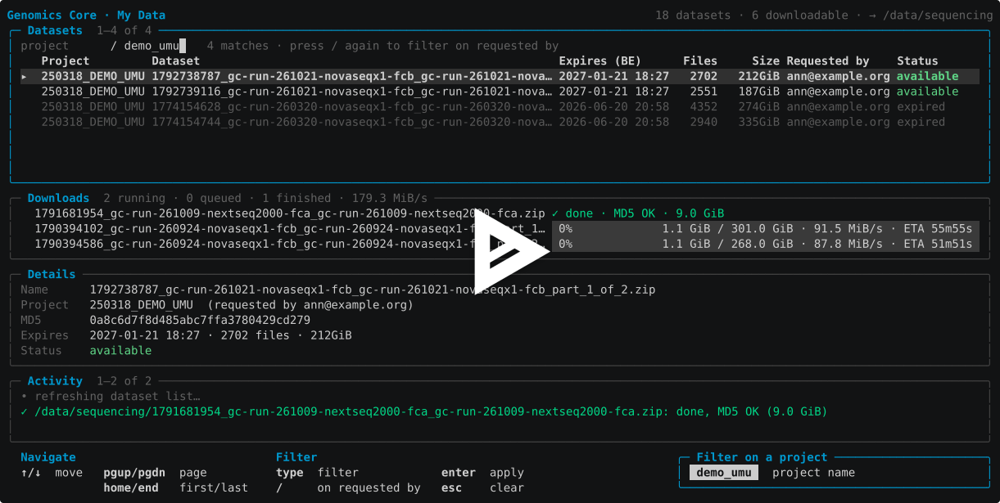

# gcdl – Genomics Core downloader

`gcdl` is a terminal program to download datasets from the
[Genomics Core Leuven portal](https://pm.genomicscore.be/) without a browser.

It logs in to the portal, lists the datasets under **My Data › My Storage
Service** and downloads the ones you select:

- several downloads at once, with progress and speed per download;
- interrupted downloads resume where they stopped (data is written to
  `<file>.part` and renamed when complete);
- every download is checked against the MD5 checksum shown on the portal;
- files that already exist in the output directory are skipped;
- expired datasets are shown, but cannot be downloaded.

The password can optionally be saved in a file, encrypted with a passphrase
of your choice (Linux and macOS only).

## Screencast

[](https://asciinema.org/a/1271340)

## Building

Requires Go 1.27 or newer.

Install the latest version:

```sh
go install github.com/ghuls/genomics_core_downloader/cmd/gcdl@latest
```

Or build from a checkout:

```sh
git clone https://github.com/ghuls/genomics_core_downloader.git
cd genomics_core_downloader
go build ./cmd/gcdl
```

Run the tests with `go test ./...`.

## Usage

```
gcdl [options]

  -o, --output string     directory to download datasets to (default ".")
  -u, --user string       portal username (default $GENOMICSCORE_USER)
  -j, --jobs int          number of downloads to run in parallel (default 2)
  -l, --list              do not start the TUI: log in, print the dataset table and exit
      --save-password     save the portal password encrypted with a passphrase of your choice
                          (in $XDG_CONFIG_HOME/gcdl/credentials.json) and exit
      --forget-password   delete the saved password and exit
      --version           print the version and exit
      --color string      colours: auto, never, 16, 256 or truecolor
                          (auto treats tmux/screen as 256 colours; NO_COLOR is honoured) (default "auto")
```

### Examples

Start the interface and download to `/data/sequencing`:

```sh
gcdl -u my.login -o /data/sequencing
```

Print the dataset table (with MD5 checksums) and exit. When the output is not
a terminal, the table is plain text, so it can be used in scripts:

```sh
gcdl -u my.login --list > datasets.txt
```

### Saving the password

```sh
gcdl --save-password
```

This asks for your username and portal password, checks them by logging in,
and asks for a passphrase (twice). The password is stored encrypted in
`$XDG_CONFIG_HOME/gcdl/credentials.json` (usually
`~/.config/gcdl/credentials.json`) with Argon2id and XChaCha20-Poly1305. The
file is readable only by you, and `gcdl` refuses to use it if its permissions
are too open.

Next time, `gcdl` asks only for the passphrase. Press tab on the login screen
to type the password instead. Remove the saved password with:

```sh
gcdl --forget-password
```

Saving the password is not available on Windows.

### Keys

The key panel at the bottom of the screen shows the keys of the focused panel.

#### All panels

| Key                    | Alternative           | Action                                        |
|------------------------|-----------------------|-----------------------------------------------|
| `tab` / `shift+tab`    |                       | next / previous panel                         |
| `↑` / `↓`              | `k` / `j`             | move (scroll in Activity)                     |
| `pgup` / `pgdn`        | `ctrl+b` / `ctrl+f`   | page up / down                                |
| `home` / `end`         | `g` / `G`             | first / last                                  |
| `esc`                  |                       | clear the filter, else back to `Datasets`     |
| `q`                    |                       | quit (asks first while downloads are running) |

#### Datasets

| Key     | Alternative | Action                                              |
|---------|-------------|-----------------------------------------------------|
| `space` |             | select / deselect                                   |
| `a`     |             | select / deselect all downloadable                  |
| `d`     | `enter`     | download the selected datasets (or the current one) |
| `x`     |             | cancel the download of the current dataset          |
| `/`     |             | filter                                              |
| `e`     |             | hide / show expired datasets                        |
| `r`     |             | refresh the list                                    |

#### Downloads

| Key | Alternative | Action                       |
|-----|-------------|------------------------------|
| `x` |             | cancel                       |
| `d` | `enter`     | retry                        |
| `c` |             | clear finished downloads     |

#### While typing a filter

The filter matches the dataset name; all words must match. `/` switches it to the
project or requester.

| Key                                         | Alternative         | Action                                                                |
|---------------------------------------------|---------------------|-----------------------------------------------------------------------|
| `/`                                         |                     | filter on the next field: `dataset name` → `project` → `requested by` |
| `enter`                                     | `tab`               | apply the filter                                                      |
| `esc`                                       |                     | clear the filter                                                      |
| `↑` / `↓`, `pgup` / `pgdn`, `home` / `end`  |                     | move in the filtered list                                             |
| `←` / `→`                                   | `ctrl+b` / `ctrl+f` | move in the filter text                                               |
| `ctrl+a` / `ctrl+e`                         |                     | start / end of the filter text                                        |
